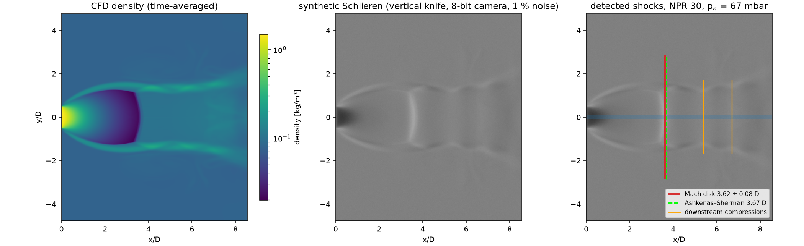
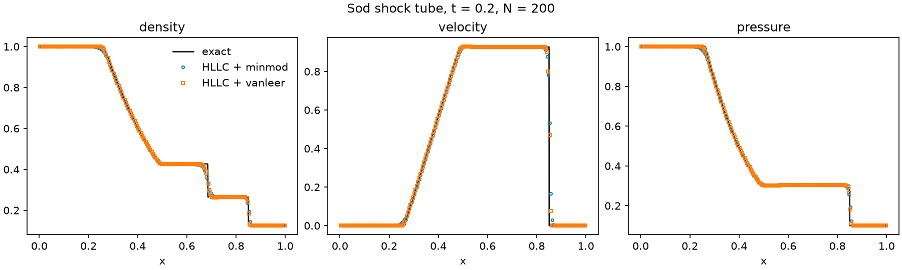
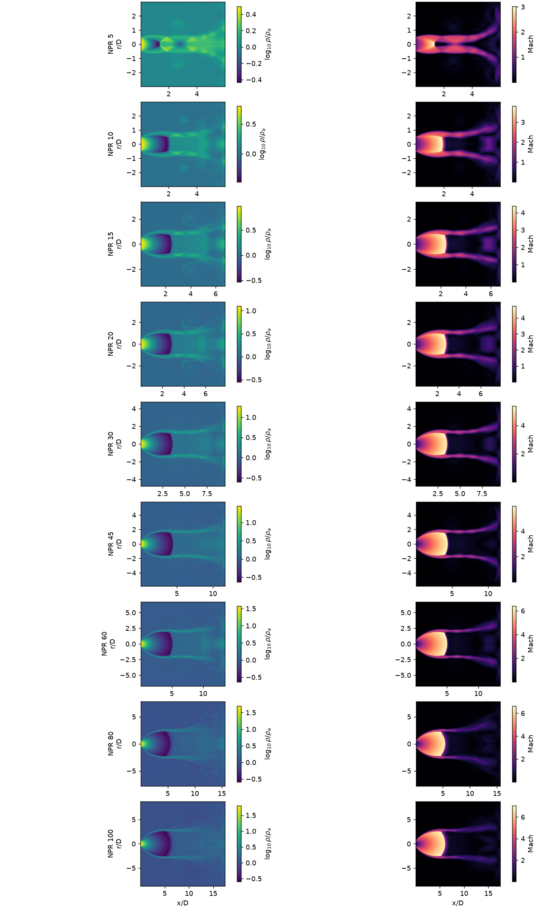
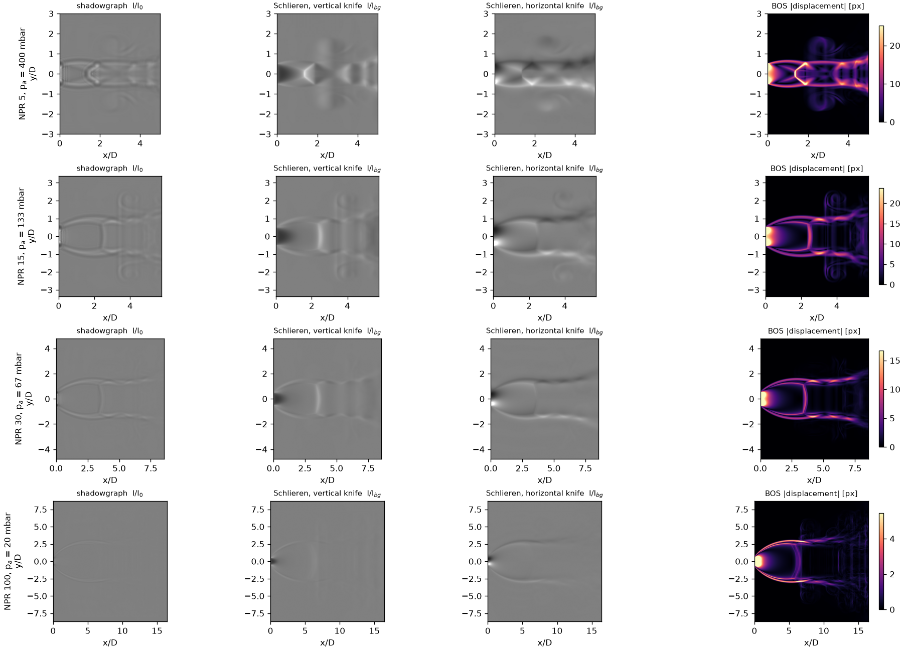
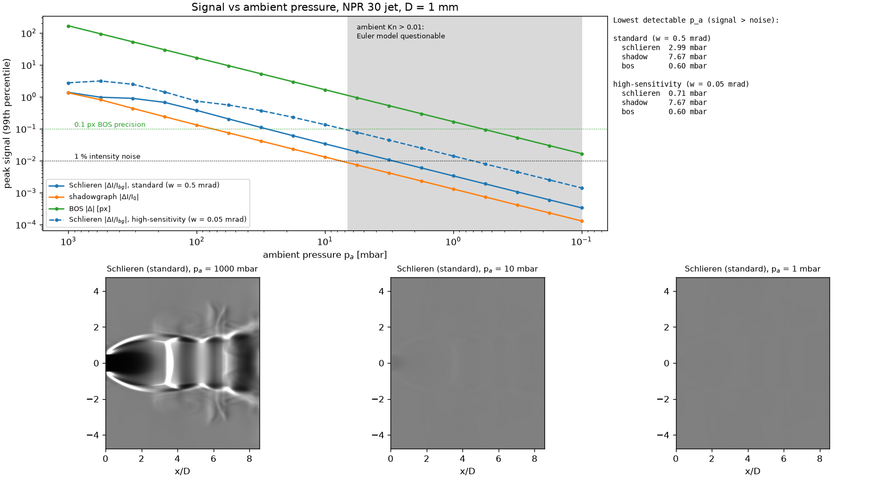
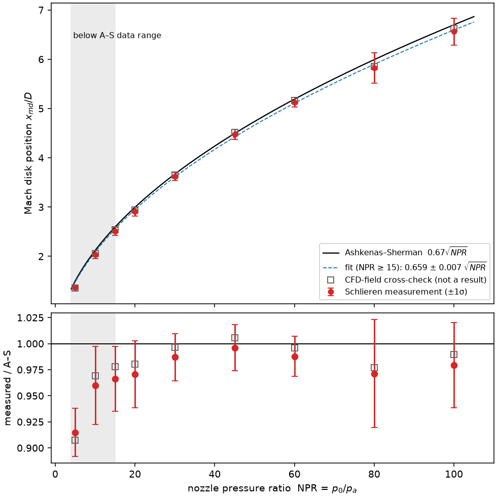
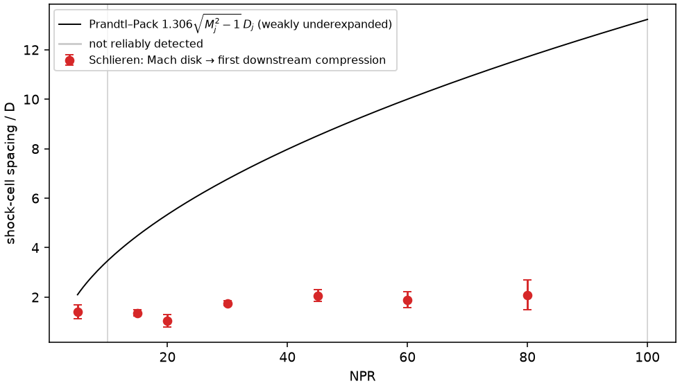
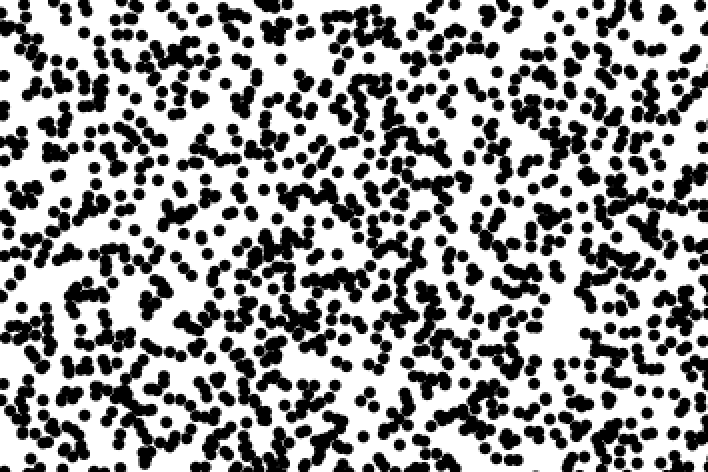
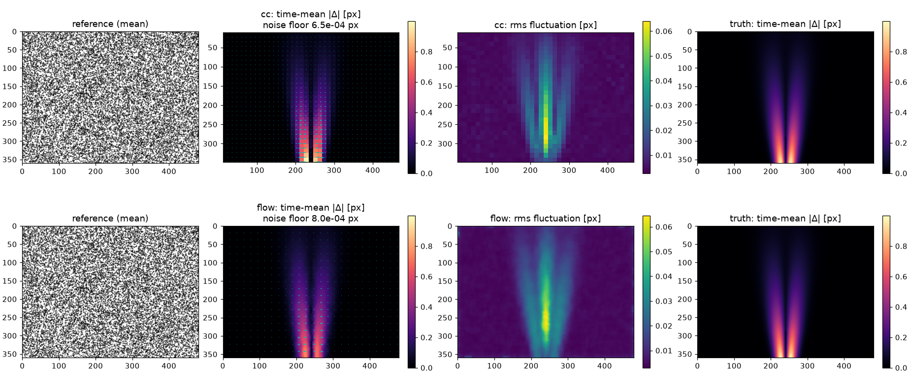

# schlieren-jet-lab

Simulated underexpanded jet → synthetic Schlieren images → automated shock measurement → comparison with theory, plus a small home background-oriented Schlieren (BOS) experiment.

## Progress

| Stage | Status |
|---|---|
| 1. Flow solver (`flow/`) | ✅ done |
| 2. Synthetic Schlieren (`optics/`) | ✅ done |
| 3. Shock analysis (`analysis/`) | ✅ done |
| 4. BOS experiment (`experiment/`) | ✅ code + synthetic validation done; real footage pending |
| 5. Packaging, CI, final README | ⏳ next |

Every number below is copied from a file in `results/` that a script writes; the file is named next to each number.


*NPR 30 jet at p_a = 67 mbar. Left: CFD density. Middle: synthetic knife-edge Schlieren through an 8-bit camera model. Right: the Mach disk and downstream compressions found automatically in that image.*

```bash
uv venv && uv pip install -r requirements.txt
python -m pytest tests     # 30 tests, ~13 s on CPU
python -m flow.sod         # Sod validation         -> results/sod_metrics.json, figures/sod.png
python -m flow.jet         # NPR sweep, GPU ~7 min  -> results/flow/*.npz, figures/jet_overview.png
python -m optics.render    # synthetic images ~1 min -> results/optics/*, figures/optics_*.png
python -m analysis.run     # shock measurement ~8 s -> results/analysis/shock_metrics.json, figures
python -m experiment.bos --synthetic   # BOS pipeline on a synthetic recording ~15 s
```
`--fast` on `flow.jet` / `optics.render` / `analysis.run` runs a small CPU-sized version (used by CI later).

---

## Stage 1: flow solver (`flow/`)

**Scheme** ([flow/euler.py](flow/euler.py)): a 2D finite-volume Euler solver in PyTorch that runs on CPU or GPU.
- MUSCL reconstruction of the primitive variables, with a minmod or van Leer limiter.
- HLLC Riemann solver with Einfeldt wave speeds.
- SSP-RK2 time stepping with a CFL-limited step; ideal gas, γ = 1.4.
- `torch.compile` fuses each RK step (3.5× faster on GPU).

**Geometry: axisymmetric (x, r).**
- It uses the true finite-volume form: cell volume r·dr, face areas r±dr/2, and the radial pressure force p/r as the only source term.
- So mass is conserved to machine precision and gas at rest stays exactly at rest. Both are checked in [tests/test_sod.py](tests/test_sod.py).

**Validation: Sod shock tube vs the exact Riemann solution** ([flow/riemann_exact.py](flow/riemann_exact.py), [flow/sod.py](flow/sod.py)).
- L1(ρ) error at N = 200 is 4.2e-3 with minmod and 2.8e-3 with van Leer.
- The observed order is 0.80–0.91. Below 1 is expected for a solution with a contact discontinuity.
- Runs along x and along y give bit-identical results.
- Source: `results/sod_metrics.json`.



**Jet case** ([flow/jet.py](flow/jet.py)):
- **Nozzle and reservoir:** sonic nozzle (M = 1 at the exit) into quiescent gas, with NPR = p0/p_a ∈ {5, 10, 15, 20, 30, 45, 60, 80, 100}. The reservoir temperature equals the ambient temperature.
- **Units:** non-dimensional (ambient ρ, p; nozzle diameter D). There's no viscosity, so the flow depends only on NPR and γ.
- **Grid:** 40 cells per D. The domain grows with √NPR, up to 697 × 348 cells at NPR 100.
- **Boundaries:** thin-lipped nozzle with an open back boundary, Riemann-invariant far field on the open sides, and a sponge layer in the outer 40% of the radius.
  - A first version had a closed back wall and no sponge. It trapped start-up vortices in the ambient gas, and their edges projected into fake "shocks" in the Schlieren images. Removing that is what the open boundary and sponge are for.
- **Time-averaged output:** the inviscid shear layer and the subsonic flow behind the Mach disk never become steady. The saved fields are averages over 3 jet transit times, which is what a continuous-light Schlieren exposure records. Each run also saves 8 instantaneous snapshots ("short-exposure frames") for the uncertainty analysis in stage 3.
- **Convergence:** the supersonic core before the Mach disk is steady. The median change between consecutive averaging windows is ≤ 5.0e-4 for all 9 NPRs, so all are marked `converged` (`results/flow/summary.json`).
- **Runtime:** 433 s for the whole sweep on a Tesla T4 (`results/flow/summary.json`).



## Stage 2: synthetic Schlieren (`optics/`)

**Chain:** CFD density → refractive index → optical path difference (OPD) through the jet → three synthetic diagnostics.

1. **Gladstone–Dale** ([optics/gas.py](optics/gas.py)): n − 1 = K·ρ with K = 2.26e-4 m³/kg for air. That gives n − 1 = 2.72e-4 for standard air, matching refractometry (tested).
   - **Dimensional setup:** D = 1 mm, T = 293 K, reservoir p0 = 2 bar, so p_a = p0/NPR runs from 400 to 20 mbar. This is like pumping a chamber down at a fixed feed pressure.
   - Because the inviscid flow is self-similar in pressure, ρ = ρ_nd · ρ_a(p_a) is exact within the model.
2. **Abel projection** ([optics/abel.py](optics/abel.py)): integrate Δn along the line of sight.
   - OPD(x, y) = ∫ Δn dz, computed with exact chord lengths through the solver's annular shells.
   - Ambient density is subtracted, so the finite domain adds no edge.
   - Tested on a uniform cylinder and on a Gaussian, whose projection is known analytically.
3. **Image formation** ([optics/imaging.py](optics/imaging.py)): the test section is a thin phase screen E = exp(ik·OPD), and ray deflection is ε = ∇OPD.
   - **Knife-edge Schlieren:** a 4f system with a half-plane filter in the Fourier plane.
     - The knife orientation and its offset into the source image are parameters.
     - A finite incoherent source of angular half-width w is modelled as a sum of tilted plane waves, each shifting the spectrum across the knife.
     - The test reproduces the geometric-optics response I/I_bg − 1 = ε/(w − a_knife) on a known smooth phase step to within 3%. It also checks that flipping the knife inverts the contrast and that a knife parallel to the gradient is blind to it.
   - **Shadowgraph:** paraxial Fresnel propagation over a distance L = 5 cm. The test checks the weak-object limit I − 1 = −L·∇²OPD and energy conservation.
   - **BOS:** background displacement Z_D·ε with Z_D = 0.5 m, converted to pixels of 10 µm projected onto the background.
   - **Sampling:** the phase is upsampled until it changes by at most 0.5 rad per pixel (up to 16×). Intensity is then box-averaged back to camera pixels. The last 1 D at the outflow boundary is cropped from the field of view.

Standard Schlieren system: w = 0.5 mrad, vertical knife cutting half the source.



Peak signal (99th percentile over the image) across the sweep (`results/optics/contrast_vs_pressure.json`):

| NPR | p_a [mbar] | Schlieren \|ΔI/I_bg\| | shadowgraph \|ΔI/I₀\| | BOS \|Δ\| [px] |
|---:|---:|---:|---:|---:|
| 5 | 400 | 0.44 | 0.16 | 21.1 |
| 10 | 200 | 0.46 | 0.14 | 20.1 |
| 15 | 133 | 0.41 | 0.13 | 18.0 |
| 20 | 100 | 0.32 | 0.11 | 14.8 |
| 30 | 66.7 | 0.24 | 0.088 | 11.1 |
| 45 | 44.4 | 0.16 | 0.062 | 8.0 |
| 60 | 33.3 | 0.12 | 0.048 | 6.2 |
| 80 | 25.0 | 0.072 | 0.036 | 4.9 |
| 100 | 20.0 | 0.064 | 0.030 | 4.2 |

**Contrast vs ambient pressure** (NPR 30 jet, p_a from 1 bar to 0.1 mbar):
- Every signal scales linearly with p_a. The Schlieren signal also saturates at high p_a, once deflections exceed the source half-width.
- Detectability thresholds: 1% intensity noise for Schlieren and shadowgraph, 0.1 px for BOS.

The lowest detectable ambient pressures (`results/optics/contrast_vs_pressure.json`) are:

| system | Schlieren | shadowgraph | BOS |
|---|---:|---:|---:|
| standard (w = 0.5 mrad) | 2.99 mbar | 7.67 mbar | 0.60 mbar |
| high-sensitivity (w = 0.05 mrad) | 0.71 mbar | 7.67 mbar | 0.60 mbar |

- **Diffraction caps the gain from a smaller source.** Shrinking the source 10× improves the Schlieren threshold only about 4×. At w = 0.05 mrad the knife's diffraction scale λ/w ≈ 13 mm is larger than the jet itself, so the knife no longer acts as a sharp angle filter.
- **The continuum model breaks down first.** At D = 1 mm the ambient gas has a Knudsen number above 0.01 below p_a = 6.65 mbar (same file). Most of the "detectable" range of the sensitive systems therefore lies where the Euler model itself becomes questionable. A real low-pressure experiment needs a rarefied-gas model (e.g. DSMC) to go with the better optics.



## Stage 3: shock analysis (`analysis/`)

The measurement uses only the synthetic Schlieren images, never the CFD fields.

**Camera model:** 8-bit sensor, background at 128 counts, 1% rms noise, saturation at 255.

**Detector** ([analysis/shocks.py](analysis/shocks.py)). With a vertical knife, a compression (density rising along x) appears bright and the expansion core appears dark.
- **Mach disk:** the first significant bright peak in a centreline band |y| ≤ 0.1 D. Significance means prominence above 5× the band noise (estimated robustly from the image background) and at least 20% of the strongest peak. A parabolic fit gives the sub-pixel position.
- **Shock cells:** behind the Mach disk the axis carries a subsonic mixing core, and the cells live in the supersonic annulus around it. They're searched for as bright bands in a band as wide as the jet, |y| ≤ 0.4·x_md.

**Estimator and uncertainty** ([analysis/run.py](analysis/run.py)).
- The simulated Mach disk oscillates axially, by up to about 0.8 D peak to peak at NPR 80–100. The reported position is therefore the **mean over the 8 short-exposure frames**, as from a high-speed camera.
  - In a long-exposure (time-averaged) image of such a smeared, sometimes bimodal disk, the brightest point can sit at one end of its travel: 5.43 D instead of 5.82 D at NPR 80. That value is kept only as a secondary column in the JSON.
- The 1σ error bar combines three terms in quadrature:
  - **noise:** spread over 20 camera-noise realisations;
  - **jitter:** the full frame-to-frame spread, not the standard error of the mean, so it's conservative;
  - **grid:** one CFD cell, D/40, since a captured shock is about 2 cells wide.
- **Cell spacing** (Mach disk → first downstream compression) uses the median over frames, with jitter = 1.4826·MAD. It's reported only if found in at least 75% of frames with relative jitter below 0.3.
- **Detection rate:** the Mach disk was found in 100% of noise realisations and frames at every NPR, with a median peak signal-to-noise ratio of at least 21.

**Validation:**
- **Unit tests** ([tests/test_analysis.py](tests/test_analysis.py)):
  - A toy axisymmetric jet with a normal shock at a known position, rendered through the full Abel → Schlieren → camera chain, is located to within 0.011 D (under half a pixel).
  - Synthetic shock-cell bands are recovered.
  - Pure noise yields no detection.
- **CFD cross-check, not used as a result:** the steepest axial density rise on the axis, averaged over the same frames, agrees with the image measurement to within 1.2% at every NPR.

Results (`results/analysis/shock_metrics.json`):

| NPR | p_a [mbar] | x_md/D (Schlieren) | σ noise / jitter / grid | A–S 0.67√NPR | measured / A–S | CFD cross-check | first cell spacing / D | Prandtl–Pack / D |
|---:|---:|---:|---|---:|---:|---:|---:|---:|
| 5 | 400.0 | 1.37 ± 0.03 | 0.000 / 0.024 / 0.025 | 1.50 | 0.915 | 1.36 | 1.41 ± 0.28 | 2.10 |
| 10 | 200.0 | 2.03 ± 0.08 | 0.001 / 0.075 / 0.025 | 2.12 | 0.960 | 2.05 | not detected | 3.47 |
| 15 | 133.3 | 2.51 ± 0.08 | 0.001 / 0.077 / 0.025 | 2.59 | 0.966 | 2.54 | 1.36 ± 0.13 | 4.49 |
| 20 | 100.0 | 2.91 ± 0.10 | 0.002 / 0.093 / 0.025 | 3.00 | 0.971 | 2.94 | 1.04 ± 0.24 | 5.34 |
| 30 | 66.7 | 3.62 ± 0.08 | 0.003 / 0.079 / 0.025 | 3.67 | 0.987 | 3.66 | 1.75 ± 0.10 | 6.77 |
| 45 | 44.4 | 4.48 ± 0.10 | 0.004 / 0.096 / 0.025 | 4.49 | 0.996 | 4.52 | 2.06 ± 0.24 | 8.52 |
| 60 | 33.3 | 5.13 ± 0.10 | 0.006 / 0.097 / 0.025 | 5.19 | 0.988 | 5.17 | 1.89 ± 0.32 | 10.00 |
| 80 | 25.0 | 5.82 ± 0.31 | 0.047 / 0.305 / 0.025 | 5.99 | 0.971 | 5.85 | 2.09 ± 0.59 | 11.72 |
| 100 | 20.0 | 6.56 ± 0.27 | 0.018 / 0.271 / 0.025 | 6.70 | 0.979 | 6.63 | not detected | 13.23 |

**Mach disk vs Ashkenas–Sherman:**
- Over the correlation's data range (NPR ≥ 15), a weighted fit of x_md = C·√NPR gives **C = 0.659 ± 0.007**, against the correlation's 0.67 (1.6σ). The mean deviation is −2.0% and the largest is 3.4%.
- Reduced χ² = 0.15: the stated error bars are conservative, because the full jitter spread is used.
- Below the data range the simulation falls further under the correlation, with a ratio of 0.915 at NPR 5.
- This −2% offset is well inside the scatter usually quoted for the Ashkenas–Sherman fit. Grid convergence of the CFD hasn't been checked yet, so it isn't attributed to physics.



**Shock cells:**
- The first cell after the Mach disk is 1.0–2.1 D long wherever it's detected (7 of 9 NPRs), with no clear trend in NPR.
- The Prandtl–Pack vortex-sheet estimate grows from 2.1 to 13 D. Pack's model describes weakly underexpanded jets *without* a Mach disk. In these jets the downstream cells form in the thin supersonic annulus around the subsonic core, so the disagreement is expected rather than a failure.
- The first-cell length is also the least robust quantity here: instantaneous frames disagree by 10–30%.



## Stage 4: home BOS experiment (`experiment/`)

A small real background-oriented Schlieren (BOS) setup for a **subsonic demonstration**: a heat-gun plume or a gas-duster jet in front of a printed dot pattern. **It is not a supersonic measurement.** BOS uses the physics of stages 1–3 in reverse: a camera focused on a random background behind the flow sees the background shift by Δ = Z_D·ε, where ε = ∇OPD is the same ray deflection that the synthetic Schlieren images were built from.

**Pieces:**
- **Background** ([experiment/pattern.py](experiment/pattern.py)): a random-dot pattern at exact physical size. The A4 version with 0.5 mm dots, 40% coverage, is in `results/experiment/pattern.pdf`; print it at 100% ("actual size").
  - Choose the dot size so each dot covers about 2–3 camera pixels: dot_mm ≈ 2.5 × (background width in mm)/(image width in px).
  - Smaller dots lock the sub-pixel estimate onto integer pixels; larger dots blunt the correlation peak.
- **Displacement** ([experiment/processing.py](experiment/processing.py)), two methods:
  1. **Window cross-correlation:** 24 px windows with 50% overlap, FFT-based, three-point Gaussian sub-pixel peak fit, and normalised-median outlier replacement, followed by 2 passes of iterative image deformation. A single pass underestimates shifts by up to 0.05 px (loss of pairs at window edges); the deformation passes remove that bias.
  2. **OpenCV Farnebäck dense optical flow.**
- **One command** ([experiment/bos.py](experiment/bos.py)) records from a webcam or loads a video, then:
  - averages the reference frames;
  - compares every flow frame against that mean and removes camera shake as the field-median shift;
  - writes the time-mean displacement, its rms fluctuation, and a **noise floor measured on the reference frames themselves** (leave-one-out, no flow).
- **Design calculator** ([experiment/design.py](experiment/design.py)) predicts the shift for a hot plume, reusing the stage 2 Gladstone–Dale and Abel code.
  - For a Gaussian index profile the peak deflection is ε_max = √(2π)·e^(−1/2)·|Δn₀| ≈ 1.52·|Δn₀|, independent of the plume width (tested).


*30 × 20 mm crop of the printable pattern (0.5 mm dots).*

**Expected signal** (`results/experiment/design.json`): Z_D = 0.5 m between plume and background, 0.2 mm of background per pixel (≈ 400 mm field on a 1920 px sensor), and a plume with a Gaussian temperature excess ΔT.

| ΔT [K] | peak deflection [µrad] | background shift [µm] | shift [px] |
|---:|---:|---:|---:|
| 10 | 13.7 | 6.9 | 0.03 |
| 20 | 26.7 | 13.3 | 0.07 |
| 50 | 61.7 | 30.8 | 0.15 |
| 100 | 109.9 | 55.0 | 0.27 |
| 200 | 181.7 | 90.9 | 0.45 |

A heat-gun plume therefore shifts the background by only a few tenths of a pixel. That makes sub-pixel accuracy, frame averaging and the measured noise floor the essential parts of the pipeline.

**Validation on a synthetic recording** (`python -m experiment.bos --synthetic` → `results/experiment/synthetic/bos.json`).
- **Input:** 20 reference and 40 flow frames, 480 × 360 px, saved as lossless FFV1 video and processed through the same video path as real footage. The flow is a swaying plume-like displacement field (true time-mean peak about 0.9 px), with 1% sensor noise and 0.05 px rms random camera jitter per axis.

| method | rms error of time-mean field [px] | 99th-pct error [px] | random noise floor, single frame [px] | camera shake removed (rms) [px] | runtime [s] |
|---|---:|---:|---:|---:|---:|
| cross-correlation | 0.0095 | 0.046 | 0.0041 | 0.064 | 9.2 |
| Farnebäck flow | 0.023 | 0.095 | 0.0051 | 0.088 | 3.4 |



- **Error budget:** the error against the truth is larger than the random noise floor because it also contains a systematic part, the window averaging of a field that varies on the window scale. The noise floor reported for real footage is therefore a *lower bound* on the error.
- **Tests** ([tests/test_experiment.py](tests/test_experiment.py)):
  - uniform sub-pixel shifts of 0.3 and 1.7 px are recovered to 0.01 px with cross-correlation and 0.06 px with Farnebäck;
  - the plume field is recovered;
  - outlier replacement and shake removal work;
  - the full video pipeline runs end to end;
  - the Gaussian-plume deflection formula holds.
- **Window size:** the 24 px default was chosen after 32 px windows gave 2–5× larger errors on narrow plumes.

**Running it at home:**
```bash
python -m experiment.pattern --dot-mm 0.5            # print results/experiment/pattern.pdf at 100 %
python -m experiment.design --zd 0.5 --footprint-mm 0.2   # expected signal for your geometry
python -m experiment.bos --camera 0 --ref-seconds 2 --flow-seconds 5 --name heatgun   # webcam
python -m experiment.bos --video phone.mp4 --ref 0:30 --flow 90: --name heatgun       # phone video
```
- **Camera setup:** tripod; focus locked on the pattern; exposure and white balance locked (phone "pro" mode or AE/AF lock); flow about 0.5 m in front of the pattern; small aperture so the plume isn't too blurred.
- **Safety:** keep the heat gun's hot nozzle away from the paper. "Compressed-air" dusters usually contain a refrigerant gas (often flammable), not air: use them away from heat sources and ventilate.

## Known limitations so far
- **Euler only:** no viscosity, turbulence or condensation. The shear layer is resolved only by the grid, and the far field isn't physical.
- **Continuum assumption:** questionable below about 7 mbar ambient at D = 1 mm (see above).
- **Grid convergence of the jet:** not yet quantified, only one resolution (40 cells per D).
- **Optics:** paraxial, thin-phase-object approximation. The knife is ideal (no lens aberrations), and the camera model has noise and quantisation but no blur.
- **Shock analysis:** the Mach-disk oscillation is that of an *inviscid* simulation, so the jitter term is model-dependent. The shock-cell spacing is fragile: frames disagree by 10–30%, and it's undetected at NPR 10 and 100.
- **BOS experiment:** so far validated only on synthetic data. The webcam recording path couldn't be exercised on this headless VM (no camera), while the video-file path is tested. Real footage is still pending.
- **Gas:** air only; real lithography-tool jets may use other gases (K and γ differ).
